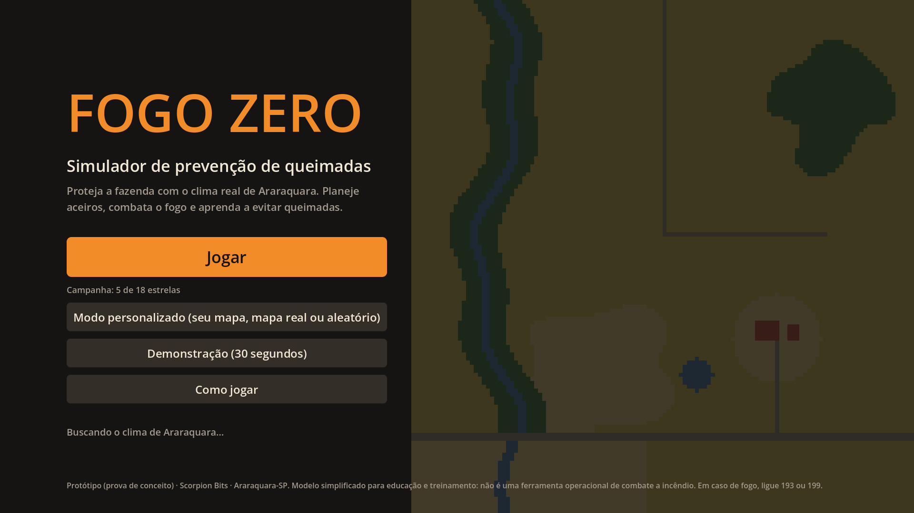
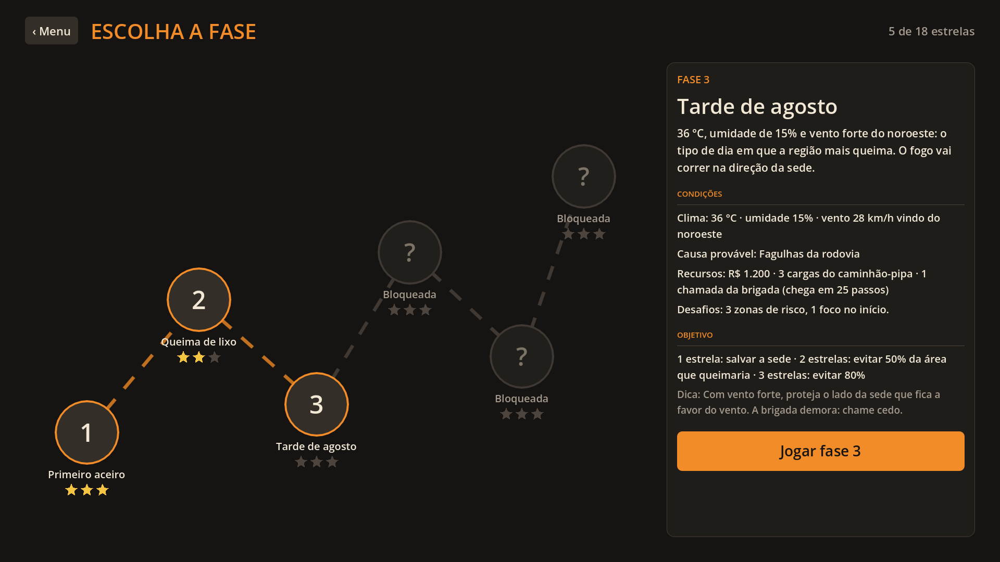
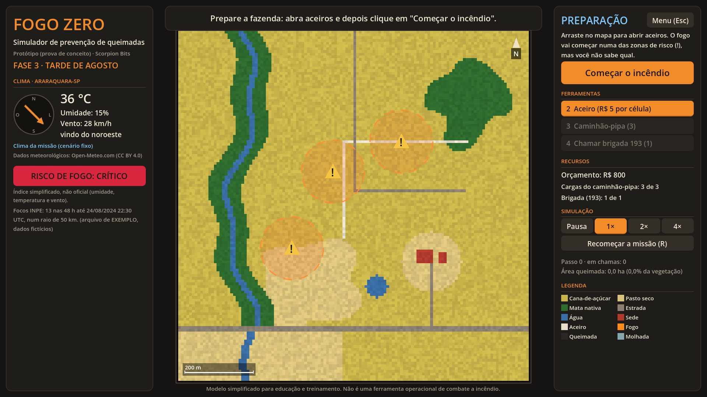
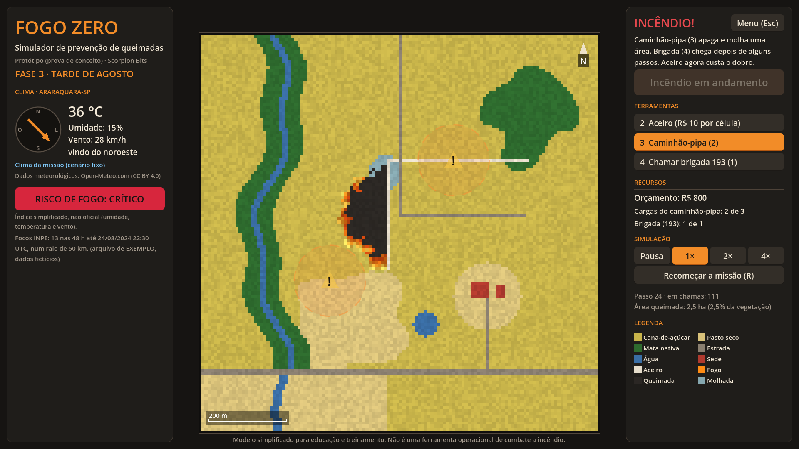
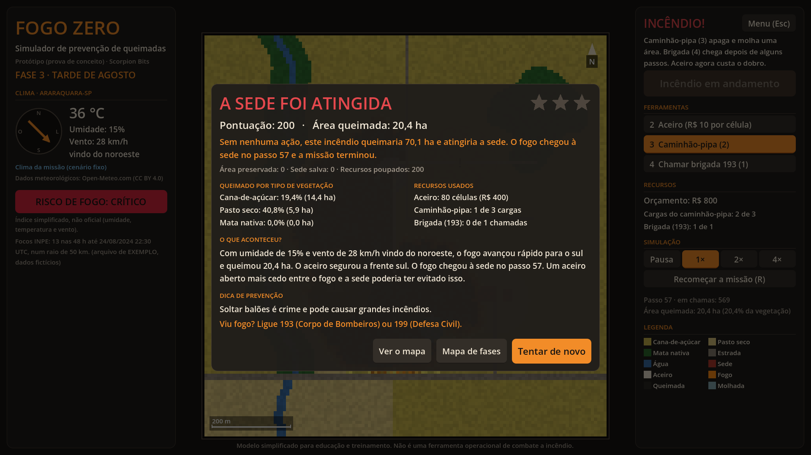
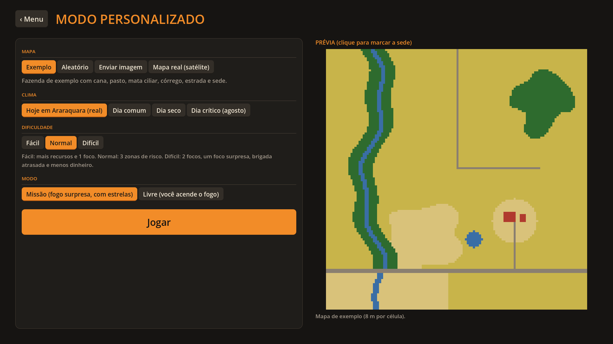
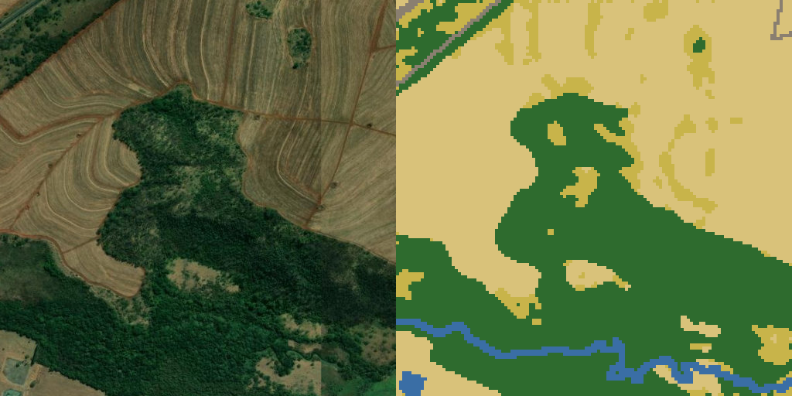

# Fogo Zero: simulador de prevenção de queimadas (protótipo)

Prova de conceito (TRL 3) da **Scorpion Bits** (Araraquara-SP) para o *Edital Startups da Prefeitura de
Araraquara*. É um jogo e ferramenta de treinamento em que o fogo se espalha pelo mapa de uma propriedade
rural de acordo com o **clima real do dia** (vento, umidade e temperatura), e o jogador usa aceiros,
caminhão-pipa e brigada para proteger a sede.

**Jogue no navegador:** https://scorpionbits.com/Fogo-Zero/ (campanha de 6 fases, modo personalizado com
mapa real por satélite e a demonstração de 30 s, tudo a partir do menu).

> **Aviso:** este é um **modelo simplificado para educação e treinamento**. **Não** é uma ferramenta
> operacional de combate a incêndio e não deve ser usado para tomar decisões reais. Em caso de fogo,
> ligue **193 (Corpo de Bombeiros)** ou **199 (Defesa Civil)**.

"Fogo Zero" é um nome provisório. Para trocar, edite `nome_projeto` em `recursos/simulacao_config.tres`.

| Menu inicial | Mapa de fases |
|---|---|
|  |  |
| **Preparação (zonas de risco e aceiros)** | **Incêndio** |
|  |  |
| **Resultado com estrelas** | **Modo personalizado** |
|  |  |

Mapa real gerado no jogo (área rural a sudoeste de Araraquara): à esquerda a foto de satélite, à direita a
grade do jogo. Imagem: Esri, Maxar, Earthstar Geographics. Estradas e córrego: © colaboradores do OpenStreetMap.



Vídeo da demonstração: [`capturas/demo.mp4`](capturas/demo.mp4)

---

## O que o protótipo demonstra

| Pergunta | Como é demonstrado |
|---|---|
| Dá para transformar um mapa (imagem) numa grade de simulação? | PNG com paleta fixa → grade 128×128. Script Python: GeoTIFF multiespectral → NDVI → `mapa_terreno.png` + `mapa_secura.png` |
| O fogo se propaga de forma crível? | Autômato celular com vento, umidade, tipo de vegetação e secura. Testes automáticos conferem o comportamento (veja [Testes](#testes)) |
| O jogo puxa o clima real de Araraquara? | Open-Meteo via `HTTPRequest`, com modo offline e modo manual |
| O jogador consegue agir e ver o efeito? | Aceiro, caminhão-pipa e brigada (193), com recursos limitados e uma tela de resultado com "O que aconteceu?" |
| Dá para medir o efeito da prevenção? | Cada missão roda, em paralelo, o mesmo incêndio sem nenhuma ação. A nota é a área que o jogador evitou |
| Funciona com lugares reais? | Modo personalizado baixa a foto de satélite e o OpenStreetMap de qualquer ponto e monta o mapa na hora |

---

## Como abrir e rodar

1. Instale a **Godot 4.3 ou mais nova** (feito e testado na 4.7.2), versão padrão (não precisa da .NET).
2. Na Godot, clique em **Importar**, escolha `project.godot` desta pasta e depois em **Executar (F5)**.

Pela linha de comando:

```bash
godot --path .
```

Para abrir direto no modo demonstração:

```bash
godot --path . -- --demo
```

### Como jogar

O jogo abre no **menu inicial**: *Jogar* (campanha), *Modo personalizado*, *Demonstração* e *Como jogar*.

Cada missão tem duas etapas:

1. **Preparação.** O mapa mostra as **zonas de risco** (círculos com "!"). O fogo vai começar dentro de
   uma ou mais delas, mas o jogador não sabe quais. Só dá para abrir aceiros, com o orçamento da missão.
   Quando estiver pronto, o jogador clica em **Começar o incêndio** (ou Enter).
2. **Incêndio.** O fogo começa sozinho. O caminhão-pipa e a brigada passam a funcionar, e o aceiro custa o
   dobro (é trabalho de emergência). Em algumas fases o vento muda de direção ou surge um foco novo num
   lugar inesperado.

A missão termina quando o fogo acaba (e não há mais eventos) ou quando o fogo chega à sede.

| Ação | Como |
|---|---|
| Abrir aceiro | ferramenta **2** e **arraste** no mapa. R$ 5 por célula na preparação, R$ 10 durante o incêndio |
| Caminhão-pipa | ferramenta **3** e clique: molha um círculo de raio 5 e apaga o fogo nele |
| Chamar brigada (193) | ferramenta **4** e clique: depois de alguns passos, ela apaga a frente de fogo num raio de 9 |
| Acender foco | ferramenta **1**, só no modo livre do modo personalizado |
| Começar o incêndio | botão na direita ou **Enter** |
| Pausar / continuar | **Espaço**, ou os botões Pausa, 1×, 2× e 4× |
| Recomeçar a missão | **R** (mesma missão, mesmo sorteio) |
| Voltar | **Esc** ou o botão *Menu* |

### Campanha, dificuldade e pontuação

A campanha tem **6 fases** (`scripts/campanha.gd`), da mais fácil para a mais difícil. As fases ficam
mais difíceis com clima mais seco e vento mais forte, zonas de risco maiores e mais numerosas, dois focos
iniciais, foco surpresa, vento que muda de direção, menos dinheiro e cargas, e a brigada mais lenta:

| Fase | Clima | Desafios |
|---|---|---|
| 1. Primeiro aceiro | 31 °C, UR 32%, vento 10 km/h | 2 zonas, 1 foco, R$ 1.500 |
| 2. Queima de lixo | 33 °C, UR 25%, vento 16 km/h | 3 zonas, mapa gerado, R$ 1.300 |
| 3. Tarde de agosto | 36 °C, UR 15%, vento 28 km/h | 3 zonas grandes do lado do vento, R$ 1.200 |
| 4. Vento virando | 34 °C, UR 20%, vento 18 → 24 km/h | o vento vira de leste para sul, foco surpresa, R$ 1.000 |
| 5. Noite de balões | 32 °C, UR 18%, vento 20 km/h | 4 zonas, 2 focos, foco surpresa, brigada em 30 passos |
| 6. Seca histórica | 38 °C, UR 12%, vento 32 km/h | 4 zonas, 2 focos, foco surpresa, 2 cargas, brigada em 35 passos, R$ 1.000 |

**Como a nota é calculada.** Quando o incêndio começa, o jogo roda em segundo plano uma **simulação de
referência**: o mesmo incêndio (mesmo sorteio, mesmo clima, mesmos eventos) no mapa original, sem nenhuma
ação do jogador. Assim dá para dizer, no fim, quanto ele evitou:

* **1 estrela:** a sede foi salva;
* **2 estrelas:** evitou pelo menos 50% da área que queimaria;
* **3 estrelas:** evitou pelo menos 80%.

Pontos: `1000 × fração evitada` + 500 se a sede foi salva + recursos poupados (orçamento ÷ 10, 30 por carga
e 60 por chamada que sobraram). Se o fogo chega à sede, a missão é perdida e não há estrelas. Sem nenhuma
ação, o jogador e a referência são o mesmo incêndio, então nada foi evitado.

As estrelas e o recorde de cada fase ficam em `user://progresso.cfg` (no navegador, no armazenamento do
site). Uma fase abre quando a anterior tem pelo menos 1 estrela. O script `testes/calibrar_fases.gd` mostra,
para cada fase, o incêndio de referência e o resultado de uma estratégia simples.

### Modo personalizado

| Opção | Escolhas |
|---|---|
| Mapa | **Exemplo**, **Aleatório** (com semente), **Enviar imagem** ou **Mapa real (satélite)** |
| Clima | **Hoje em Araraquara (real)**, Dia comum, Dia seco ou Dia crítico (agosto) |
| Dificuldade | Fácil, Normal ou Difícil (recursos, zonas, focos, foco surpresa e atraso da brigada) |
| Modo | **Missão** (fogo surpresa, com estrelas) ou **Livre** (o jogador acende o fogo, sem estrelas) |

Clicar na prévia marca a sede (útil quando o mapa não tem construções).

* **Enviar imagem:** aceita um PNG na paleta do jogo (o resultado do `converter_mapa.py`) ou uma foto aérea
  comum (PNG, JPG ou WebP). O jogo reconhece sozinho qual é qual. Uma foto é recortada no centro, reduzida
  para 128×128 e classificada pela cor (`scripts/classificador_foto.gd`, a mesma ideia do modo `rgb` do
  script Python). No computador abre a janela de arquivos (e dá para arrastar o arquivo para a janela); no
  navegador, um seletor de arquivos do próprio navegador lê a imagem (nada é enviado a servidor nenhum).
* **Mapa real (satélite):** um quadrado de **1,28 km × 1,28 km** (10 m por célula) em volta de uma
  coordenada, de um lugar buscado pelo nome ou de um dos lugares prontos da região. O jogo baixa:
  1. a **foto de satélite** da Esri World Imagery (`MapServer/export`), classificada pela cor em cana,
     palha/pasto seco e mata, com um filtro que tira os pontinhos isolados;
  2. as **estradas, rios, lagos e construções do OpenStreetMap** pela Overpass API, desenhados por cima
     (estrada vira barreira, rio e lago viram água, construção vira sede).

  A busca de lugares usa o Nominatim (OpenStreetMap). Tudo é feito por `HTTPRequest` e funciona também
  no navegador. A precisão é bem menor que a do drone: pela cor não dá para separar com segurança palha
  seca de solo exposto, nem sombra de água, então o jogo usa só o OpenStreetMap para água e estradas.

> **Licenças do mapa real.** A atribuição aparece na tela. A imagem da Esri é usada aqui como protótipo;
> para um produto comercial é preciso uma conta e uma chave da Esri (há plano gratuito) ou trocar a fonte
> (`URL_FOTO` em `scripts/mapa_real.gd`), por exemplo pelo Sentinel-2. Os dados do OpenStreetMap são ODbL e
> os servidores públicos da Overpass e do Nominatim têm limites de uso. Em produção, o ideal é um servidor
> intermediário com cache.

---

## Clima real (Open-Meteo)

O painel esquerdo busca o clima atual de Araraquara (lat −21,7946, lon −48,1756) na
[Open-Meteo](https://open-meteo.com/) ao abrir o jogo e depois a cada 15 minutos (`intervalo_clima`):

```
https://api.open-meteo.com/v1/forecast?latitude=-21.7946&longitude=-48.1756&current=temperature_2m,relative_humidity_2m,wind_speed_10m,wind_direction_10m&timezone=America/Sao_Paulo
```

* O painel mostra a temperatura, a umidade, o vento (velocidade e uma seta para onde ele sopra), o horário da
  leitura e a atribuição obrigatória **"Dados meteorológicos: Open-Meteo.com (CC BY 4.0)"**.
* **Modo offline:** sem internet ou se a API falhar (tempo limite de 10 s), o jogo usa os valores
  padrão do Resource e avisa no HUD.
* **Cenário manual:** controles deslizantes de temperatura, umidade, vento e direção. O botão
  *"Dia crítico (como agosto de 2024)"* usa 36 °C, 15% de umidade e vento de 30 km/h vindo do noroeste.
* **Índice de risco (simplificado, NÃO oficial):**
  `risco = 0,5·(1 − UR/100) + 0,25·norm(T, 15–40 °C) + 0,25·norm(vento, 0–40 km/h)`.
  As faixas são Baixo (< 0,35), Médio (< 0,55), Alto (< 0,75) e Crítico. A tela deixa claro que o índice não é oficial.
* **Focos do INPE (opcional):** baixe um CSV de focos no
  [BDQueimadas](https://terrabrasilis.dpi.inpe.br/queimadas/bdqueimadas/) e salve como
  `dados/focos_inpe.csv`. O HUD mostra quantos focos houve num raio de 50 km nas 48 h anteriores ao
  registro mais recente do arquivo. As colunas `lat`/`latitude`, `lon`/`longitude` e
  `data_hora_gmt`/`datahora` são reconhecidas. Na Godot, selecione o CSV, abra a aba **Importar**, escolha
  **Keep File (exported as is)** e clique em *Reimportar*, porque, sem isso, a Godot tenta importar o CSV
  como tradução. Enquanto não houver um arquivo real, o jogo usa `dados/focos_exemplo_ficticio.csv`, que
  tem **dados fictícios**, e avisa isso na tela.

---

## Modelo de propagação

Cada célula tem um **tipo de terreno**, uma **secura** (de 0 a 255) e um **estado**: `INTACTA`, `QUEIMANDO`
(com o tempo de queima restante), `QUEIMADA` ou `MOLHADA` (por N passos, depois volta a `INTACTA`).

A cada passo, cada célula queimando tenta acender cada vizinha intacta (vizinhança de Moore, 8 células) com
a probabilidade:

```
p = p_base(tipo da vizinha) × f_secura × f_umidade × f_vento × f_diagonal

f_secura   = secura_min + (secura_max − secura_min) × secura/255      (0,5 a 1,5; 128 ≈ 1,0)
f_umidade  = clamp((1 − UR/100)^k, 0,05, 1)                            (k = 2)
f_vento    = exp(c × velocidade_kmh × cos θ)                           (c = 0,035)
f_diagonal = 1/√2 nas diagonais, 1 nas laterais
```

* `θ` é o ângulo entre a direção **para onde** o vento sopra e a direção da vizinha. A Open-Meteo informa de
  onde o vento vem, como é o padrão meteorológico, então o modelo soma 180°.
* Uma célula `MOLHADA` tem a chance multiplicada por `fator_molhada` (0,02).
* A célula queima por um número de passos que depende do tipo. Depois vira `QUEIMADA` e não queima de novo.
* **Barreiras** (estrada, aceiro e água) têm `p_base = 0`. Os aceiros são traçados sem "furos" diagonais,
  já que, com 8 vizinhas, uma linha só com passos diagonais deixaria o fogo passar.
* É **determinístico**: um único `RandomNumberGenerator` com semente, e as células são percorridas sempre na
  mesma ordem.

### Constantes (`recursos/simulacao_config.tres`)

Abra o arquivo no Inspetor da Godot para ajustar. Não é preciso mexer no código.

| Tipo | Cor | `p_base` | Queima (passos) |
|---|---|---|---|
| Cana-de-açúcar | `#C8B44A` | 0,30 | 5 |
| Pasto seco | `#D9C27A` | 0,42 | 3 |
| Mata nativa | `#2E6B2E` | 0,13 (queima devagar) | 12 (por mais tempo) |
| Construção / sede | `#B03A2E` | 0,10 | 14 |
| Estrada / aceiro | `#8A7F70` | 0 (barreira) | n/a |
| Água | `#3A6EA5` | 0 (barreira) | n/a |

O mesmo arquivo também guarda: `k_umidade` = 2, `c_vento` = 0,035, `fator_diagonal` = 0,7071,
`secura_min` = 0,5, `secura_max` = 1,5, 6 passos por segundo em 1×, semente 2024, o clima padrão offline,
os pesos do índice de risco, os recursos do jogador e os parâmetros do modo demonstração.

### Calibração

Os valores foram escolhidos para cumprir os critérios de aceite. Resultados do teste automático, numa grade
uniforme de cana de 96×96 com vento de 8 km/h e média de 10 sementes:

| Umidade | Células queimadas |
|---|---|
| 15% | ~9.200 (quase o mapa todo) |
| 30% | ~9.150 |
| 50% | ~5.700 |
| 75% | ~3 (o foco morre) |
| 85% | ~2 |

Com vento de oeste a 30 km/h e UR de 35%, o fogo queima cerca de 5,7 vezes mais a favor do vento do que contra.

---

## Como trocar o mapa

Pelo jogo, o jeito mais fácil é o **modo personalizado** (veja acima). Para trocar o mapa padrão:

1. Crie um PNG com **exatamente as cores da tabela acima** (um pixel = uma célula). Tamanhos diferentes de
   128×128 são reamostrados. Cores parecidas também funcionam, porque cada pixel vira o tipo da cor mais próxima.
2. Opcional: crie a camada de secura com o mesmo nome trocando `terreno` por `secura` (ex.:
   `fazenda_terreno.png` + `fazenda_secura.png`). É um PNG em tons de cinza em que 0 é úmido e 255 é muito seco.
3. No modo personalizado, use **Enviar imagem** ou arraste o arquivo para a janela. No computador, a secura
   ao lado é carregada sozinha; no navegador, use o botão *Camada de secura*. Para mudar o mapa padrão
   (usado nas fases 1, 3 e 6), altere `mapa_terreno` e `mapa_secura` no Resource.

O **mapa de exemplo** (`mapas/exemplo_*.png`) é uma fazenda fictícia com córrego e mata ciliar, uma
mancha de mata nativa, pasto, carreadores, estrada municipal, açude e a sede com um piquete. Ele é gerado
por `ferramentas/gerar_mapa_exemplo.py`. O mapa **Aleatório** e as fases 2, 4 e 5 usam o gerador
procedural `scripts/gerador_mapa.gd`.

---

## Pipeline de dados do drone (Python)

`ferramentas/converter_mapa.py` transforma a imagem do drone nos dois PNGs do jogo.

```bash
cd ferramentas
python3 -m venv .venv
.venv/bin/pip install -r requirements.txt     # numpy, Pillow, rasterio
cd ..
```

Primeiro gere o GeoTIFF sintético de teste e converta. A saída vai para `mapas/`, e o jogo abre o resultado
no modo personalizado (*Enviar imagem*):

```bash
ferramentas/.venv/bin/python ferramentas/converter_mapa.py sintetico
```

```bash
ferramentas/.venv/bin/python ferramentas/converter_mapa.py ndvi dados/teste_sintetico.tif --banda-vermelho 3 --banda-nir 5 --banda-verde 2 --nome drone_teste
```

No GeoTIFF real do drone, troque os índices das bandas. **A ordem das bandas do drone do CEPIN ainda não é
conhecida**, então confira no QGIS ou com `rio info` e passe os números certos (a primeira banda é 1):

```bash
ferramentas/.venv/bin/python ferramentas/converter_mapa.py ndvi voo_cepin.tif --banda-vermelho R --banda-nir N --nome fazenda --sede 90,80,6,5
```

Para uma imagem RGB comum (sem NDVI), a classificação é aproximada, pela cor de referência mais próxima:

```bash
ferramentas/.venv/bin/python ferramentas/converter_mapa.py rgb foto_aerea.jpg --nome fazenda
```

**Como o script funciona**

1. Lê só as bandas pedidas e faz um **recorte central** com a proporção da grade, para não distorcer a imagem.
2. Reamostra para 128×128 (`--largura`, `--altura`) pela **média por área** (`Resampling.average`).
3. Calcula `NDVI = (NIR − Vermelho) / (NIR + Vermelho)` e classifica por limiares configuráveis:
   - abaixo de `--limiar-agua` (0,0): água;
   - abaixo de `--limiar-solo` (0,18): estrada ou solo exposto;
   - abaixo de `--limiar-pasto` (0,42): pasto seco;
   - abaixo de `--limiar-cana` (0,72): cana;
   - acima disso: mata.

   Com `--banda-verde`, telhados avermelhados (vermelho > 1,6 × verde) viram construção. Também dá para marcar
   a sede à mão com `--sede X,Y,LARGURA,ALTURA` (em células, pode repetir).
4. Calcula a secura a partir do NDVI: `--ndvi-seco` (0,15) vira 255, `--ndvi-umido` (0,85) vira 0, e a água fica com 0.
5. No modo `rgb`, ajusta o brilho, classifica pela cor de referência mais próxima e usa o índice VARI
   `(G − R)/(G + R − B)` no lugar do NDVI para a secura.

**Validação feita:** o GeoTIFF sintético (640×512 px, 5 bandas em float32, EPSG:31982, gerado a partir do
mapa de exemplo com ruído) foi convertido para uma grade **100% igual** ao mapa de exemplo, e a secura
reconstruída tem correlação de 0,67 com a original. O teste da Godot confirma que o jogo carrega esse
resultado. O modo RGB também reproduz o mapa na foto RGB sintética, mas só porque essa foto foi pintada com
as próprias cores de referência. Numa foto real, os limiares e as cores precisam ser calibrados.

---

## Modo demonstração (vídeo do pitch)

O modo demonstração usa o mapa de exemplo, a semente 815 e um dia crítico (36 °C, UR de 15% e vento de 30 km/h
vindo do noroeste). O roteiro dura uns 30 s:

1. Um foco começa no canavial.
2. A equipe abre um aceiro em L para proteger a sede.
3. A brigada é acionada pelo 193.
4. O caminhão-pipa molha a frente de fogo que se aproxima do aceiro.
5. A brigada chega e corta a frente leste.
6. O fogo para e a sede é salva.

Legendas no topo explicam cada etapa e, no fim, aparece a tela de resultado. O roteiro fica em `scripts/demo.gd`,
com tudo amarrado aos passos da simulação, então o vídeo sai sempre igual.

O vídeo já gravado está em `capturas/demo.mp4` (1920×1080, 60 fps, 37 s: 30 s de simulação mais a tela de
resultado). Para gravar de novo (precisa do ffmpeg). A cena é renderizada fora da tela, numa SubViewport,
então o tamanho da janela e o mouse não interferem, e a gravação leva uns 3 minutos:

```bash
ferramentas/gravar_demo.sh capturas/demo.mp4
```

---

## Exportar

Os presets de exportação já estão em `export_presets.cfg`: Web, Linux e Windows. Antes, é preciso instalar
os **modelos de exportação** da mesma versão da Godot (*Editor → Gerenciar modelos de exportação → Baixar*).

```bash
godot --headless --path . --export-release "Web" exportar/web/index.html
```

* O export Web usa o renderizador **Compatibility** e **não usa threads** (`variant/thread_support=false`),
  então roda em qualquer servidor estático, inclusive no itch.io e no GitHub Pages, sem cabeçalhos especiais.
* A chamada à Open-Meteo funciona no navegador, porque a API permite CORS.
* Para testar localmente: `cd exportar/web && python3 -m http.server 8000` e depois abra `http://localhost:8000`.
* No Web, *Enviar imagem* usa o seletor de arquivos do navegador (`JavaScriptBridge`): a imagem é lida no
  próprio navegador, sem acesso ao disco e sem enviar nada a servidores. O mapa real (Esri, Overpass e
  Nominatim) também funciona, porque esses serviços permitem CORS.
* O progresso da campanha fica salvo no armazenamento do site (por navegador).
* Publicado no GitHub Pages (branch `gh-pages`) e testado com a Godot 4.7.2 no Chromium: menu, mapa de
  fases, missão completa com estrelas, progresso salvo após recarregar, envio de imagem, mapa real
  (satélite + OpenStreetMap), clima real e o modo demonstração (passo 149, 32,7 ha, sede salva).
  A versão Web baixa cerca de 40 MB, quase tudo no `index.wasm` da engine.

Linux e Windows, também pela linha de comando:

```bash
godot --headless --path . --export-release "Linux" exportar/linux/fogo_zero.x86_64
```

```bash
godot --headless --path . --export-release "Windows Desktop" exportar/windows/fogo_zero.exe
```

---

## Organização do projeto

```
project.godot, export_presets.cfg, icone.svg
cenas/       principal.tscn, hud.tscn, resultado.tscn
scripts/
  simulacao_fogo.gd   autômato celular (lógica pura, sem nós: testável sozinha)
  missao.gd           uma missão: mapa, clima, recursos, zonas de risco e eventos
  partida.gd          partida de uma missão: etapas, eventos e simulação de referência
  campanha.gd         as 6 fases
  progresso.gd        estrelas e recordes salvos
  classificador_foto.gd  foto aérea/satélite → grade (classificação por cor)
  mapa_real.gd        mapa real: satélite (Esri) + OpenStreetMap (Overpass) + busca (Nominatim)
  grade.gd            grade de terreno e secura e leitura dos PNGs
  terreno.gd          tipos de terreno e paleta
  simulacao_config.gd Resource com todas as constantes
  ferramentas.gd      recursos do jogador, aceiro, pipa e brigada
  renderizador.gd     desenha a grade numa única Image/ImageTexture (sem um nó por célula)
  mapa_view.gd        mostra o mapa, recebe cliques e arrastos, desenha os marcadores
  clima_api.gd        Open-Meteo (HTTPRequest) com fallback offline
  leitura_clima.gd    dados de uma leitura de clima
  risco.gd            índice de risco simplificado
  focos_inpe.gd       leitura opcional do CSV de focos do INPE
  narrador.gd         resultado, "O que aconteceu?" e dicas
  demo.gd             roteiro do modo demonstração
  gerador_mapa.gd     gerador procedural de mapas
  tela_menu.gd, tela_fases.gd, tela_personalizado.gd   telas
  hud.gd, seta_vento.gd, resultado.gd, estrelas.gd, ui.gd, principal.gd   interface
recursos/    simulacao_config.tres, tema.tres
mapas/       exemplo_terreno.png, exemplo_secura.png, drone_teste_*.png (saída do pipeline)
dados/       focos_exemplo_ficticio.csv, teste_sintetico.tif, teste_sintetico_rgb.png
ferramentas/ converter_mapa.py, gerar_mapa_exemplo.py, gravar_demo.sh, requirements.txt
testes/      teste_simulacao.gd, calibrar_fases.gd, teste_mapa_real.gd, quadros_demo.gd,
             capturar_tela.gd, gravar_demo.gd
capturas/    capturas de tela e vídeo da demonstração
```

## Testes

```bash
godot --headless --path . --import
```

```bash
godot --headless --path . -s testes/teste_simulacao.gd
```

O teste confere:

* o efeito da umidade e do vento;
* o bloqueio por estrada, água, aceiro e aceiro diagonal;
* a reprodutibilidade (mesma semente, mesmo resultado);
* os limites das ferramentas e o atraso da brigada;
* a leitura do mapa de exemplo e do mapa do pipeline Python;
* o gerador procedural;
* o modo demonstração (sede salva, duração entre 20 e 40 s, reproduzível);
* as missões: preparação, ferramentas bloqueadas antes do fogo, aceiro em dobro no incêndio, foco surpresa
  e mudança de vento, "sem ação = nada evitado" e 3 estrelas com aceiros em volta das zonas;
* a classificação de imagens (paleta × foto e acerto na foto sintética);
* o desempenho.

Na última execução, um passo mais o desenho levou cerca de **3,2 ms** com 1.157 células em chamas ao
mesmo tempo, folgado para 60 fps.

`testes/quadros_demo.gd -- --imagens=PASTA` salva quadros do modo demonstração e serve para ajustar o
roteiro. `testes/capturar_tela.gd -- --pasta=capturas` gera as capturas de tela (ele apaga o progresso
salvo), `testes/gravar_demo.gd` grava o vídeo, `testes/calibrar_fases.gd` mostra a dificuldade de cada fase
e `testes/teste_mapa_real.gd -- --lat=… --lon=… --pasta=…` baixa um mapa real e salva a foto e a grade
(precisa de internet).

---

## Decisões tomadas

* **Interface montada por código.** As cenas `.tscn` são enxutas e os controles do HUD são criados em
  `hud.gd`, a partir do Resource. Assim é fácil mudar valores sem mexer em vários nós.
* **Desenho:** uma `Image` RGBA de 128×128 numa `ImageTexture`. A cada passo só as células alteradas são
  repintadas, e a cada quadro só as que estão queimando, para a chama animar de amarelo a vermelho.
* **Aceiro do jogador:** é um tipo próprio (`ACEIRO`), mostrado num tom mais claro que a estrada para ficar
  visível. No PNG ele tem a mesma cor da estrada (`#8A7F70`).
* **Fogo apagado pela água ou pela brigada** vira `QUEIMADA` (área já atingida). As células intactas no
  círculo ficam `MOLHADA` por 45 passos.
* **"Últimas 48 h" dos focos do INPE** são contadas a partir do registro mais recente do CSV, porque o arquivo
  é baixado à mão e pode não ser de hoje.
* **Paleta visual:** como a identidade visual da Scorpion Bits não foi enviada, o protótipo usa tons de carvão
  e brasa (`#1C1A17` / `#F28C28`) e a fonte padrão da Godot. Para trocar, edite `recursos/tema.tres` e as
  constantes de cor no topo de `hud.gd` e `resultado.gd`.
* **Dados fictícios ficam marcados como fictícios:** o CSV de focos de exemplo tem isso no nome e na tela.
* **Zonas de risco em vez do ponto exato:** se o jogador visse o ponto exato, bastaria cercá-lo. Com zonas
  maiores, cercar todas custa mais que o orçamento nas fases difíceis, e ele precisa decidir o que proteger.
* **Clima fixo nas fases:** para a campanha ser justa e comparável, cada fase tem um cenário fixo. O clima
  real de hoje fica no modo personalizado. Durante o incêndio o clima não muda (só por evento da fase).
* **Foco surpresa fora das zonas** e mudança de vento anunciada só no briefing: ensinam a não gastar todo o
  orçamento antes do fogo.

## Limitações

* **É um modelo simplificado e probabilístico**, não um modelo físico de comportamento do fogo, como os
  de Rothermel ou FARSITE. Os passos não correspondem a minutos reais, e o tamanho da célula (8 m) só
  serve para converter a área em hectares.
* **Não há fagulhas ("spotting"):** o fogo nunca salta estradas ou aceiros, o que pode acontecer na
  vida real com vento forte.
* **Não há relevo:** o fogo sobe encostas mais rápido, e isso não é modelado. O vento é o mesmo em todo o mapa.
* O índice de risco é **simplificado e não oficial**. Ele não substitui o risco de fogo do INPE.
* Os limiares de NDVI e as cores de referência do modo RGB foram validados só com **dados sintéticos**.
  Eles precisam de calibração com o voo real e com verificação em campo.
* A detecção de construções pelo NDVI é aproximada. Use `--sede` para marcar a sede à mão.
* O CSV do INPE é lido de um arquivo baixado à mão, sem API automática.
* O **mapa real** classifica a foto só pela cor: palha seca e solo exposto, sombra e água se confundem, e
  os carreadores internos que não estão no OpenStreetMap não aparecem como barreira.
* A foto da Esri exige chave/licença para uso comercial, e os servidores públicos do OpenStreetMap podem
  demorar ou recusar pedidos em excesso (o jogo tenta de novo uma vez e, se falhar, usa só a foto).

## Próximos passos (projeto completo, 2027)

1. Processar os voos reais do drone multiespectral do **CEPIN/IFSP Araraquara** e calibrar os limiares de NDVI
   com amostras de campo.
2. Incluir o relevo (modelo digital de elevação do próprio voo) e fagulhas na propagação.
3. Calibrar a velocidade de propagação com cicatrizes de queimadas reais (INPE, MapBiomas Fogo) e converter os passos em minutos.
4. Integrar automaticamente o **INMET** e o **Programa Queimadas do INPE**, com um pequeno servidor
   intermediário para o export Web.
5. Criar cenários pedagógicos para escolas, brigadas e produtores rurais, com relatórios de desempenho por turma.
6. Fazer a identidade visual final, trilha sonora e acessibilidade (leitor de tela, alto contraste e daltonismo).

---

## Texto para o edital (maturidade tecnológica)

> O protótipo *Fogo Zero* encontra-se em **TRL 3 (prova de conceito experimental)** e demonstra, em ambiente
> de laboratório, a viabilidade técnica do simulador de prevenção de queimadas proposto. Ele (i) converte
> imagens aéreas multiespectrais em formato GeoTIFF numa grade de simulação, calculando o NDVI para
> classificar a vegetação e estimar a secura de cada célula (pipeline validado com dados sintéticos);
> (ii) simula a propagação do fogo por um autômato celular que responde à direção e à velocidade do vento,
> à umidade relativa do ar e ao tipo e estado da vegetação, com resultados reproduzíveis e verificados por
> testes automatizados; (iii) consulta em tempo real o clima de Araraquara por uma API aberta (Open-Meteo),
> exibindo um índice de risco simplificado; (iv) permite ao usuário testar ações de prevenção e combate,
> como aceiros, caminhão-pipa e acionamento da brigada, e ver o efeito na área queimada, recebendo ao
> final um resumo pedagógico e dicas de prevenção. Uma campanha de seis missões com dificuldade crescente
> mede o desempenho do jogador comparando cada incêndio com a mesma ocorrência sem nenhuma ação, o que
> quantifica o efeito da prevenção; e (v) monta mapas de lugares reais a partir de imagens de satélite e
> do OpenStreetMap, ou de imagens enviadas pelo usuário. Desenvolvido em Godot 4, roda em computadores e
> navegadores. As próximas etapas preveem a integração e a calibração com os dados do drone
> multiespectral do CEPIN/IFSP Araraquara e do Programa Queimadas do INPE.

---

Dados meteorológicos: [Open-Meteo.com](https://open-meteo.com/) (CC BY 4.0).
